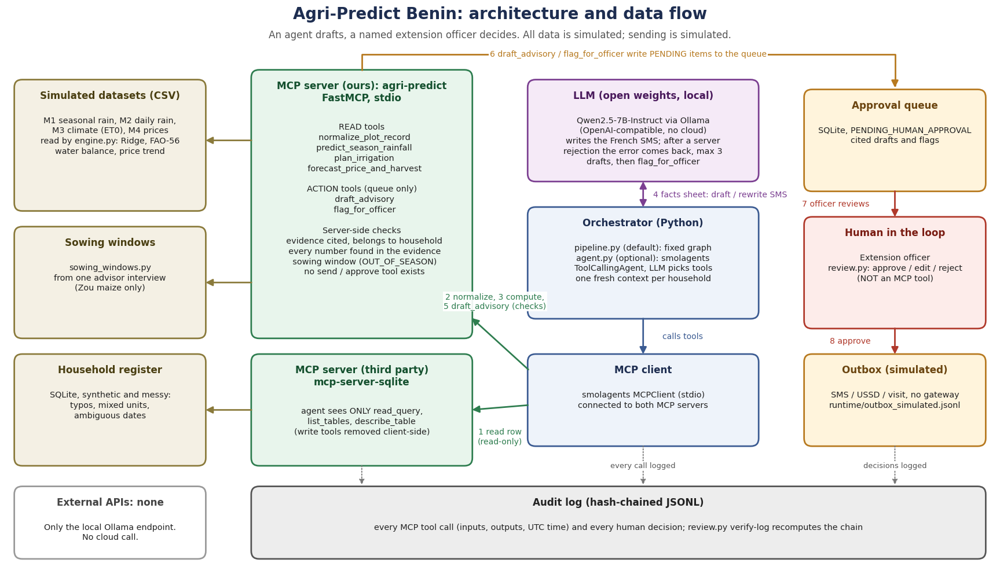

# Agri-Predict Benin: an agent that drafts, a human who decides

An agentic assistant for a Beninese agricultural extension office (DDAEP / commune desk). For each household in a
farmer collective it checks the plot record, computes rainfall scenarios, FAO-56 irrigation need and a price/harvest
outlook, and **drafts** an SMS advisory that cites its data. A named extension officer approves, edits or rejects
every draft before anything could reach a farmer. The agent has no tool that can send, approve, order inputs or raise
a credit alert.

Track: *Agriculture and food security*, sub-theme **climate-smart advice** (rain/irrigation vs. crop calendar), with
harvest/price timing as a secondary signal.

> **Read this first (honest status)**
> - All rainfall, climate and price data in `data/` is **simulated**, not observed. Advice is a demonstration of the
>   workflow, not agronomic guidance.
> - The household register is **synthetic** (no real person; ids are codes).
> - Sending is **simulated** (`runtime/outbox_simulated.jsonl`); no SMS/USSD gateway is connected.
> - Two modes. **pipeline** (default): code chains the MCP tool calls and the open-weights LLM (Qwen2.5-7B via
>   Ollama) drafts the French SMS and rewrites it when the server rejects it. **agent**: the LLM chooses every
>   tool call; with Qwen2.5-7B this failed in every development run (`LLM_DEV_LOG.md`), so it is not the default.
> - `--model scripted` runs the same system with a non-LLM writer so anyone can run it without a GPU. Only the
>   `ollama` rows in `EVALS.md` say anything about the LLM; check which are filled.
> - Known unfixed failure: sowing-season checking covers only Zou maize (from one advisor interview); elsewhere an
>   out-of-season sowing date is not detected (`EVALS.md`, A18).

## Problem statement

In Benin a few extension officers must advise hundreds of smallholder farmers (the advisor we interviewed follows about
100 to 150 producers). Each week they cross-check scattered rainfall, sowing-window and price signals against plot
records that are messy (typos, mixed units, ambiguous dates), and advice reaches farmers late and generically. In a
rain-fed smallholder economy, mistimed advice (sowing outside the window, poor water planning, selling at the wrong
time) directly affects income and food security. The bottleneck is the officer's manual preparation and verification of
advice, household by household. Full interview summary: [`FIELD_INPUT.md`](FIELD_INPUT.md).

## Solution overview

For each household of a collective, an agent reads the register, cleans the record, computes rainfall scenarios, FAO-56
irrigation need and a price/harvest outlook through MCP tools, has an open-weights LLM draft a short French SMS, and
queues it with its sources for a named officer to approve, edit or reject. Nothing is sent by software.

## Target users

- **Primary: extension officers** (district or commune desks) who prepare advice for 100+ producers.
- **Secondary: smallholder farmers**, who receive validated advice by SMS, USSD or visit (send is simulated here).
- Out of scope for now: farmers using the tool directly, input suppliers, lenders.

## Setup, installation and usage

Requirements: Python 3.10+ (tested on Python 3.14 / Windows and Python 3.12 / Linux); Ollama only for the real-LLM mode.

### Run it in one command

```bash
pip install -r requirements.txt && python -m agri_predict.demo
```

This builds the synthetic register, runs the agent loop (scripted policy, no GPU, no API key) over one collective and
lists the officer's queue. Then act as the officer:

```bash
python -m agri_predict.review list
python -m agri_predict.review show ADV-0001
python -m agri_predict.review approve ADV-0001 --officer "Your Name"   # writes a SIMULATED send + audit entry
python -m agri_predict.review verify-log                                # checks the hash chain
```

### With a real open-weights model

```bash
ollama pull qwen2.5:7b-instruct
python -m agri_predict.agent --model ollama --group GV-BOR       # pipeline mode; AGRI_MODEL / OLLAMA_URL override
python -m agri_predict.agent --model ollama --mode agent --household HH-BO-001   # LLM picks every tool (fragile)
python evals/run_evals.py episodes --model ollama --mode pipeline --repeats 3 && python evals/report.py
```

Display helpers for demos and reviews: `python -m agri_predict.show register|trace|season|guardrail` (see `agri_predict/show.py`).

Tests: `python -m pytest -q tests` (unit) and `python evals/run_evals.py tools` (tool-layer evals over real MCP stdio).

## Architecture



Simplified view:

```
 household register (SQLite, synthetic)           extension officer (human)
        |  read-only                                      ^  approve / edit / reject
        v                                                |  (review.py, NOT an MCP tool)
 mcp-server-sqlite (3rd party) --+                 queue.sqlite  <--- draft_advisory / flag_for_officer
                                 +--> smolagents agent --+              (agri-predict MCP server)
 agri-predict MCP server (ours) -+     (Qwen2.5-7B via Ollama)
   normalize_plot_record  predict_season_rainfall  plan_irrigation  forecast_price_and_harvest
   draft_advisory (action)  flag_for_officer (action)
                     every call -> audit_log.jsonl (SHA-256 hash chain)
```

The LLM does no arithmetic: figures come from tools (`engine.py`, ridge regression + FAO-56 water balance + trend
model). In pipeline mode the LLM writes the French message from a small facts sheet and rewrites it after a
rejection (`UNGROUNDED_NUMBERS`, length); in agent mode it also plans and parameterises every tool call.

## Rules and how they are enforced (in code, not in the prompt)

| Rule | Enforcement |
|---|---|
| Agent never sends, orders or raises credit alerts | No such tool exists. `evals` A14 checks the agent's tool list. Approval is `review.py`, outside MCP. |
| Every advisory cites its data | `draft_advisory` refuses without `evidence_ids` that exist in the audit log, belong to this household, and match its cleaned crop/locality/date. |
| No invented figures | Every number in the message must appear in the cited tool outputs, else `UNGROUNDED_NUMBERS` and the agent must rewrite. |
| Human decides | New rows are always `PENDING_HUMAN_APPROVAL`; only `review.py` changes state, recording officer name and time. |
| Third-party server cannot write | Its `write_query`, `create_table`, `append_insight` are dropped client-side; `read_query` also rejects non-SELECT (A15). |
| Auditable | Each tool call and each human decision is one hash-chained JSONL line (inputs, outputs, UTC timestamp, actor). Tamper-evident, not tamper-proof. |

## Technology stack

Python; MCP Python SDK (FastMCP 1.x, stdio) and the community `mcp-server-sqlite`; smolagents 1.26 (MCPClient,
ToolCallingAgent); Ollama serving Qwen2.5-7B-Instruct (open weights, local, OpenAI-compatible endpoint) through the
`openai` client library; pandas, numpy, scikit-learn (Ridge regression); SQLite (register, approval queue); JSONL
(audit log); pytest. License: MIT. External APIs: none (no cloud calls).

## Agent architecture

- **Orchestration.** `pipeline.py` (default): a fixed graph per household: read row -> normalise -> plan irrigation ->
  forecast price -> LLM drafts -> `draft_advisory` -> retry (max 3 drafts) or flag. `agent.py` (optional): a smolagents
  `ToolCallingAgent` where the LLM chooses every tool call. One fresh context per household.
- **LLM.** Qwen2.5-7B-Instruct via Ollama, only for language: the French SMS and its rewrite after a rejection.
- **Tools.** Six tools in our MCP server plus three read-only tools of the third-party SQLite server.
- **Memory.** No long-term LLM memory; state lives in the approval queue (SQLite) and the audit log.
- **Databases.** SQLite register (synthetic), SQLite approval queue, hash-chained JSONL audit log, simulated CSV datasets.
- **Why code-orchestrated by default.** With a 7B open-weights model, the free tool-calling agent failed in every
  development run (loops, empty arguments, invented ids); see [`LLM_DEV_LOG.md`](LLM_DEV_LOG.md). We kept it as an option
  and report both modes in [`EVALS.md`](EVALS.md). Details: [`ARCHITECTURE.md`](ARCHITECTURE.md).

## MCP implementation: servers and tools

Two MCP servers over stdio, connected to one MCP client (smolagents `MCPClient`). Only MCP *tools* are used (no MCP
resources or prompts).

- **Built here** (`agri_predict/mcp_server.py`, FastMCP, stdio): four read tools (`normalize_plot_record`,
  `predict_season_rainfall`, `plan_irrigation`, `forecast_price_and_harvest`) and two queue-only action tools
  (`draft_advisory`, `flag_for_officer`). Tool outputs carry `sources`,
  `limitations` and an `evidence_id`; errors are structured (`error_code`, `hint`) so an agent can recover.
- **Borrowed**: the community `mcp-server-sqlite` for read access to the household register. Writing a SQL server
  ourselves would add nothing; we only restrict what the agent may call.

## Human-in-the-loop workflow

1. The agent queues a draft advisory (`PENDING_HUMAN_APPROVAL`) or a flag for a household. It cannot do anything else.
2. The officer lists the queue (`python -m agri_predict.review list`) and opens an item (`review show ADV-0001`): the
   draft, the zone, the corrections made to the record, and every cited source with its computation time.
3. The officer **approves** (optionally editing the text; an edit with a number absent from the evidence triggers a
   warning), or **rejects** with a note, always under a named `--officer`.
4. Approval writes a `human_decision` line to the audit log and a *simulated* send to `runtime/outbox_simulated.jsonl`.
   Rejected and flagged items are never sent. `review verify-log` re-checks the audit chain.

## Data provenance and what is not covered

`data/dataset_M1..M5*.csv` are **100% simulated** by the author's Python scripts (numpy, seed 42) on 2026-09-28. **No real observation is used and nothing was downloaded from an external source.** The simulation parameters (mean rainfall per department, temperatures, base prices, seasonality) were set by the author; their original source is not documented and cannot be attributed to CHIRPS, ERA5-Land or SIM-Agricole, which are only target sources for a real version. Full description of each file, the laws used and the known limits: [`DATA.md`](DATA.md) (French original: `docs/sources_et_methodes_FR.txt`). `data/households.sqlite` is generated by
`python -m agri_predict.synth_households` (seed 7) with deliberate mess: typos, towns instead of departments, m²
without unit, ambiguous dates, missing fields, an unmodelled crop (cotton). Not covered: pest/phytosanitary alerts,
real market prices, soil data per plot, input orders and credit risk, Fon/Bariba/Dendi-language messages.

## What existed before the submission window, and what is new

| Pre-existing (from the earlier Streamlit prototype) | Built for this challenge |
|---|---|
| `agri_predict/engine.py` (agronomic models; Gemini explainer removed; ET0 now Hargreaves-Samani, corrected 2026-10-14), `data/dataset_M*.csv` (generated 2026-09-28) | MCP server, normalisation, grounding check, audit log, approval queue + officer CLI, synthetic register, smolagents/MCP agent, evals, docs |

Commit history shows the split: the prototype is the first commit, everything else follows.

## Limitations

- Sowing-season checking exists only for Zou maize, from one advisor interview (`sowing_windows.py`); for every other department/crop the season is **not checked** (EVALS A18 still fails for Borgou). Irrigation totals use simulated climate, Kc values not re-checked one by one
  against FAO-56 (yam is probably not in FAO-56) and assumed soil parameters; treat magnitudes with suspicion until an
  agronomist validates them.
- Rain scenarios use a fixed random seed (42) so runs are reproducible; they are not a probabilistic ensemble.
- The scripted policy was written by the same author as the tools; passing it proves integration, not LLM skill.
- Qwen2.5-7B needed several design changes before it could be run at all; see `LLM_DEV_LOG.md` for each failure.
- The grounding check proves every number comes from the cited data, not that the LLM gave it the right meaning (a first Qwen draft presented a whole-season water total as belonging to three weeks). Facts are now labelled explicitly, but the officer's review is the real control.
- Messages are French only; documentation is English per the rules.

## Future improvements

Messages in local languages (Fon, Bariba, Dendi, Yom) validated by speakers; richer SMS content requested by the advisor
(urgency, disease signs to watch, nearby market prices, transport and storage costs); sowing windows for more
departments and crops, from more advisor interviews; real data (CHIRPS, ERA5-Land, SIM-Agricole) replacing the
simulated sets; a real SMS/USSD gateway behind the approval step; an officer web interface; signed external anchoring of
the audit log; validation of Kc values and irrigation figures with an agronomist; a field pilot with a district office.

## Field input

One face-to-face interview with an extension advisor of the Zou department; summary, how it was recorded, and the changes it caused are in [`FIELD_INPUT.md`](FIELD_INPUT.md).

License: MIT.
